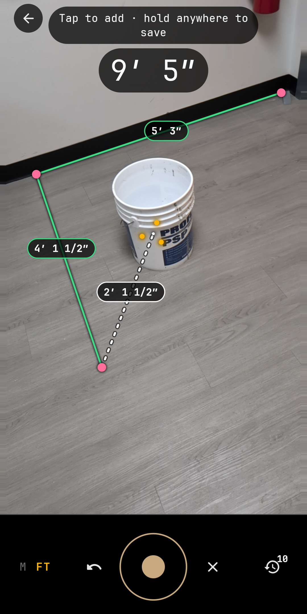
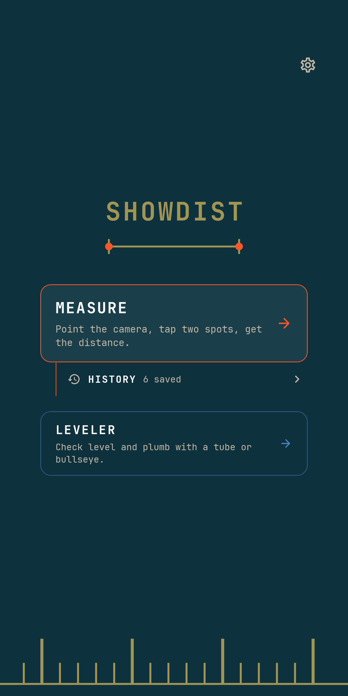
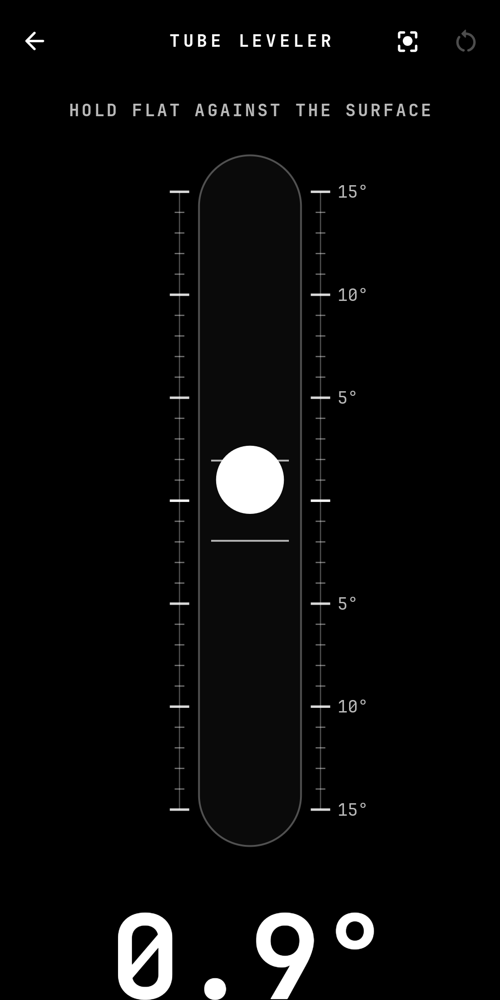

# Showdist

Measure distances with your camera in AR, plus a bubble level. No ads, offline.

Showdist is a tape measure and a bubble level for Android, built with Kotlin and
Jetpack Compose. Point your camera at a floor, wall or table, tap to drop points,
and read the distance as you go. Switch to the tube or bullseye level when you
need to hang something straight.

  

## Features

- AR measuring: chain up to 24 points, per-segment lengths and a running total
- Metric or imperial (feet and inches to the nearest half inch)
- History with thumbnails, "View in AR" to project a saved shape back into the room
- PDF report export, or share/copy as text
- Tube and bullseye levels with calibration
- No account, no ads, no analytics. Measurements stay on your phone.

## Requirements

Showdist needs a phone that supports **Google Play Services for AR (ARCore)**.
ARCore is proprietary Google software; the app will not run without it.

## Install

- **F-Droid:** in the F-Droid app, add the repository
  `https://carlosantoniocruz.github.io/fdroid/repo?fingerprint=0E388F97C5AA696BAC88483E8B9423590223E2AF06954483282951D970555554`
  (or open that link on your phone), then search for Showdist.
- **APK:** download from [Releases](https://github.com/carlosantoniocruz/showdist-android/releases).

## Build

```
./gradlew assembleRelease
```

Release signing reads a gitignored `keystore.properties`
(`storeFile`, `storePassword`, `keyAlias`, `keyPassword`). Without it the release
build is unsigned.

## Privacy

[Privacy policy](https://carlosantoniocruz.github.io/showdist-privacy/)

## License

[MIT](LICENSE). Bundled fonts and libraries keep their own licenses (see `app/src/main/res/raw/`).
